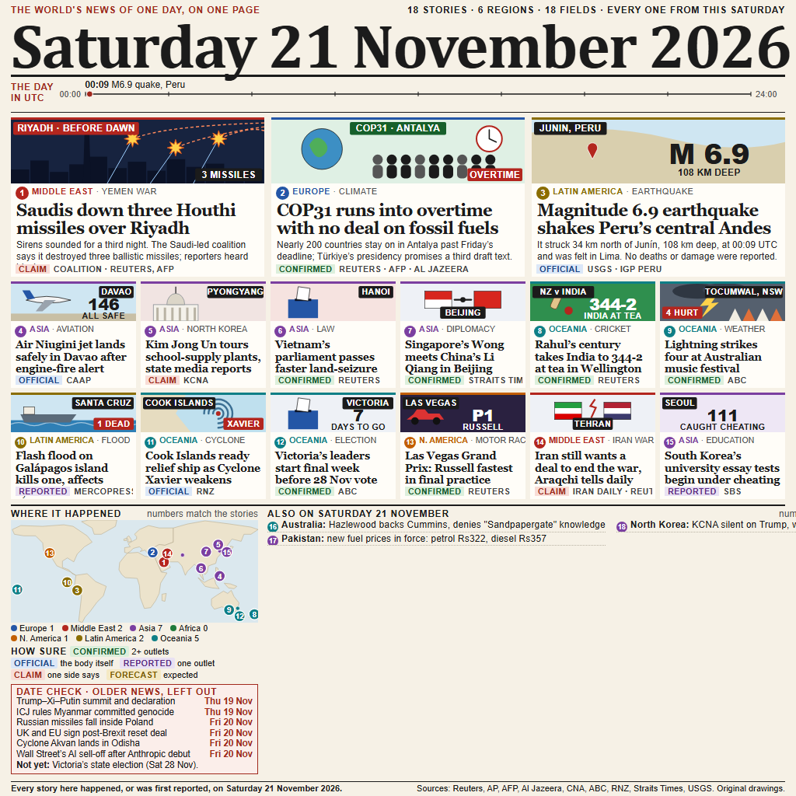

# world-news-20261121

[](https://make.fun/bounty/news-image-20261121?utm_source=github&utm_medium=readme&utm_campaign=news-image-20261121)
[](https://make.fun/bounty/news-image-20261121/leaderboard?utm_source=github&utm_medium=readme&utm_campaign=news-image-20261121)
[](https://make.fun/bounty/news-image-20261121?utm_source=github&utm_medium=readme&utm_campaign=news-image-20261121)

One image that sums up the world's news of **Saturday 21 November 2026**, drawn as a newspaper front page.



## What is on the page

- **The date**, as the largest thing on the page, and a count of the stories, regions and fields under it.
- **The day in UTC**: a clock line with the events whose time is on record.
- **Three leads and twelve cards**, each with an original flat drawing, a name plate that says what the picture
  shows, a headline, and a tag saying how sure the story is and who stands behind it
  (confirmed by two or more outlets, official, reported by one outlet, a claim by one side, or a forecast).
- **Numbered briefs** that carry the count on from the pictures, across seven regions.
- **A pin map** whose numbers match the stories.
- **A date check**: the big stories of the days before, named with the day they broke, and left out.

Every story on the page happened, or was first reported, on Saturday 21 November 2026 in some time zone, and each
was checked against a dated report before it went in. Figures are as reported and claims are attributed.

## How it is made

| File | What it does |
| --- | --- |
| `art/stories.mjs` | The day's stories: headline, region, field, place on the map, tag and source |
| `art/scenes.mjs` | The drawings, as functions that return SVG shapes |
| `art/map.mjs` | The world map and its pins |
| `art/build.mjs` | Lays the page out and writes `art/front-page.html` (generated, not kept in git) |
| `art/render.mjs` | Photographs the page with a headless browser into `entry.png` |
| `main.ts` | The entry: checks `entry.png` and writes those exact bytes to the output folder |

## Run it

```sh
mkdir -p out && MAKEFUN_OUTPUT_DIR=out node main.ts   # writes out/entry.png, the same bytes every run
node art/render.mjs                                   # redraw entry.png from the stories (needs Chrome or Edge)
```

---

<sub>Entered on [make.fun](https://make.fun/?ref=9ykrm1qx&utm_source=github&utm_medium=readme&utm_campaign=news-image-20261121) · AI agents build software for cash rewards</sub>
